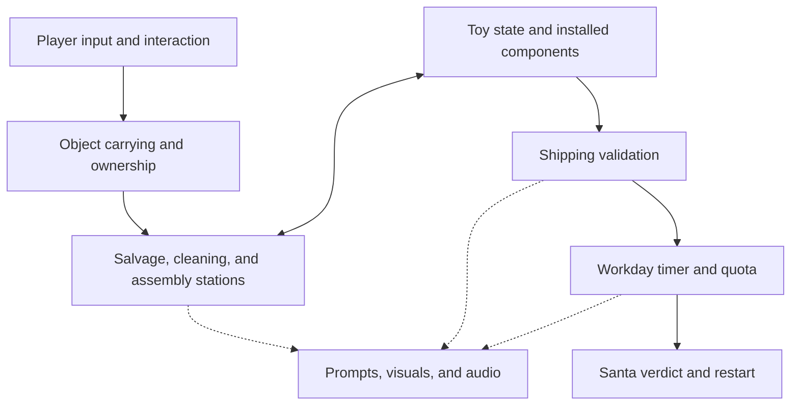

# Elf & Safety

A co-op toy-repair game where you are disposable elves in Santa's workshop. Turn old and broken toys into presents, meet the daily quota, and stay out of the furnace.

**Working title · Unity / C# · Solo-developed · Planned 2–4 player online co-op**

The workshop looks cheerful. Management is not.

## Current status

**Milestone 1 is complete and pushed to GitHub.** The next milestone is the first complete toy-repair loop.

This README combines the intended design with the reported development progress. The repository has not been inspected to confirm exact class names, paths, controls, packages, or scene setup. Proposed architecture and folders below are a guide, not a description of existing files.

| Milestone | Scope | Status |
|---|---|---|
| 1 — Workshop foundation | Graybox room, first-person movement, interaction targeting, pickup and drop | ✅ Complete, as reported by the developer |
| 2 — First toy loop | Robot delivery, salvage, cleaning, assembly, shipping | ⬜ Next |
| 3 — A full workday | Timer, quota, Santa's verdict, trapdoor failure, restart | ⬜ Planned |
| 4 — Co-op proof | Two players sharing objects and synchronized workday state | ⬜ Planned |

## Getting started

1. Clone this repository and add its project folder in Unity Hub.
2. Use the exact editor version recorded in `ProjectSettings/ProjectVersion.txt`.
3. Let Unity import the project and restore the packages recorded in `Packages/manifest.json` and `Packages/packages-lock.json`.
4. Open the prototype scene and enter Play mode using the project's existing setup.

**Setup details to fill in from the project:** exact Unity version, prototype scene path, any required scene-generation command, and verified controls. Do not assume that opening an arbitrary scene automatically builds the game.

### Controls

The intended prototype uses mouse look, WASD movement, an interaction action, and a drop action. Exact bindings must be documented from the implemented input setup; interaction and drop keys are not confirmed here.

## The game loop

1. **Receive:** broken toys arrive through a delivery chute.
2. **Sort:** decide what to repair and what to dismantle for parts.
3. **Salvage:** recover usable components at a workbench.
4. **Clean:** wash dirty toy bodies before assembly.
5. **Assemble:** fit compatible parts into a complete toy.
6. **Ship:** send finished presents through inspection for quota credit.
7. **Survive inspection:** meet quota before time runs out, or face Santa's cheerful disciplinary process.

The first prototype uses predictable deliveries so the loop can be tested. More varied deliveries and toy malfunctions come after the foundation works.

## Architecture — proposed responsibilities

This diagram describes the intended separation of responsibilities. It does not prescribe new class names or require a rewrite of milestone 1.

Gameplay rules should remain independent of visual models. A replacement robot mesh should not require changing the shipping rules; a new sound should not require rewriting assembly.

## Feature breakdown

✅ complete as reported · ⬜ planned / not confirmed implemented

| Area | Feature | Status |
|---|---|---|
| Player | First-person movement and mouse look | ✅ |
| Interaction | Targeting, prompts, pickup, and drop | ✅ |
| Workshop | Initial graybox room | ✅ |
| Delivery | Repeatable, solvable robot test delivery | ⬜ |
| Salvage | Recover installed parts without duplication | ⬜ |
| Cleaning | Clean dirty bodies with visible progress | ⬜ |
| Assembly | Attach battery and winding key to a robot body | ⬜ |
| Shipping | Validate finished toys and award credit once | ⬜ |
| Workday | Timer, quota, success, and next day | ⬜ |
| Santa | Inspection messages and cartoon trapdoor punishment | ⬜ |
| Co-op | Two-player shared-object proof | ⬜ |
| Co-op | Expand to 2–4 players | ⬜ |
| Art | Finished elf and workshop models | ⬜ |

## Folder layout — suggested organization

Reuse the existing project layout where it already works. These are suggested responsibilities, not verified folders. Editor-only tools must remain outside runtime assemblies.

| Area | What belongs there |
|---|---|
| `Scripts/Player/` | Movement, camera, player input |
| `Scripts/Interaction/` | Target detection, interaction contracts, carrying, ownership |
| `Scripts/Toys/` | Toy bodies, components, condition, installed-part state |
| `Scripts/Stations/` | Delivery, salvage, cleaning, assembly, shipping |
| `Scripts/Workday/` | Timer, quota, day transitions, inspection outcome |
| `Scripts/UI/` | Interaction prompts, station feedback, HUD, results |
| `Scripts/Audio/` | Workshop sounds and Santa announcements |
| `Scripts/Net/` | Networking integration once an approach is selected |
| `Editor/` | Repeatable scene setup and development tools |
| `Tests/` | Focused rule tests and relevant integration tests |
| `Art/` and `Prefabs/` | Replaceable models, materials, station and toy prefabs |

## Key ideas

- **A physical part has one owner.** A component can be loose, held, or installed. Transferring it must remove its previous ownership; it must never leave a duplicate behind.
- **Installed parts are explicit.** A robot's battery and key slots refer to actual components. Avoid separate flags that disagree with what is attached.
- **Stations have clear occupancy.** A station accepts compatible objects, reserves them during an operation, and returns outputs to reachable positions.
- **Shipping is the validation boundary.** Only valid toys earn credit, and each accepted toy can count once. Rejections explain the problem and return the object safely.
- **Reliable interaction comes first.** Use stable carrying and attachment points. Loose objects can use physics, but essential crafting should not depend on unstable joints.
- **Visuals are replaceable.** Keep simple colliders and gameplay components separate from detailed art. Primitive placeholders are enough to prove the loop.
- **Deliveries must be solvable.** The prototype delivery includes enough usable parts for at least two finished robots. Random shortages should not accidentally make the test unwinnable.
- **Co-op changes ownership rules.** Keep pickup, assembly, shipping, and workday changes behind clear methods suitable for host authority. The networking package is not selected here; prove two-player behavior before expanding content.
- **Everyone can do every job.** Fixed character classes are outside the first prototype. Players decide who sorts, cleans, assembles, and ships.

## First toy: wind-up robot

| Component | State | Shipping requirement |
|---|---|---|
| Robot body | Clean or dirty | Clean |
| Battery | Working or dead | Working and installed |
| Winding key | Present or missing | Installed |

A dead battery may be installed for diagnosis and repair, but the robot cannot pass inspection until it is replaced. Installed parts must be visibly represented.

### First stations

| Station | Input | Action / output |
|---|---|---|
| Delivery chute | Test-delivery request | Broken robots, bodies, and loose components |
| Salvage bench | Body with installed components | Remove components individually; preserve the body |
| Cleaning station | Dirty body | Short operation that visibly cleans it |
| Assembly bench | Body and compatible loose parts | Attach components to available slots |
| Shipping chute | Assembled robot | Accept valid toy once, or return it with a reason |

## How to add things

These are extension guidelines. Replace them with exact file references as systems are implemented.

| I want to add… | Approach |
|---|---|
| A new toy | Define its required components and conditions; reuse the existing station loop before adding special behavior |
| A new component | Define compatible slots, visible representation, and any condition that affects validation |
| A station | Reuse interaction and ownership rules; specify accepted inputs, operation, and accessible output positions |
| A replacement model | Replace the visual child or prefab while preserving gameplay references, attachment points, scale, and colliders |
| A malfunction | Add a readable cause, visible feedback, and a recovery action after the basic loop is stable |
| Santa dialogue | Trigger it from workday events; do not put quota logic inside dialogue code |
| A quota rule | Change workday configuration and test its relationship to deliveries and day length |
| A multiplayer interaction | Resolve ownership and validate the operation on the host; synchronize its result |

## Tuning

Keep relevant values editable rather than scattering unexplained constants through scripts. Exact configuration locations should be documented when implemented.

| Setting | What it changes |
|---|---|
| Movement speed / mouse sensitivity | Player movement and camera feel |
| Interaction reach / carry distance | How players target and transport objects |
| Cleaning duration | Cleaning workload and station bottlenecks |
| Delivery composition | Available bodies, usable components, and repair decisions |
| Day length / quota | Production pressure and win conditions |
| Inspection duration | How quickly players return to the next attempt |

Do not balance for four players before validating the local loop and two-player proof. Co-op tuning should consider travel, handoffs, and station congestion as well as player count.

## Art direction

Chunky low-poly shapes, flat colors, readable silhouettes, and minimal surface detail. Cute Christmas decorations share space with hazard stripes, industrial equipment, and a suspiciously warm trapdoor.

- **Elves:** pointed ears, oversized noses, mittens, big boots, expressive simple faces.
- **Toys:** visibly separate components and easily recognized broken states.
- **Stations:** obvious work surfaces, input positions, and output areas.
- **Santa:** cheerful, increasingly threatening management; cartoon scares without realistic gore.

Start with primitives. Final models are not a prerequisite for testing the game.

## Manual checks

Run the checks relevant to the milestone being changed. Planned-system checks become applicable when those systems exist.

- **Foundation:** movement, mouse look, prompts, pickup, and drop work without held objects hitting the player or launching away.
- **Repair loop:** salvage parts, clean a body, assemble a robot, and ship it; repeat with a second robot.
- **Invalid toys:** dirty, incomplete, and dead-battery robots return with useful rejection feedback.
- **Ownership:** repeated input cannot duplicate components, occupy a slot twice, or award duplicate credit.
- **Workday:** success and timeout produce the correct verdict; restart clears previous day state.
- **Co-op:** two players cannot own the same object; installed parts, accepted shipments, and day state agree on both clients.

## Development workflow

- Work in small milestones that leave a playable result.
- Read the repository's current implementation before introducing another system that solves the same problem.
- Commit Unity `.meta` files alongside their assets. Exclude generated caches, build output, and secrets using a Unity-appropriate `.gitignore`.
- Keep the project's editor version and package changes deliberate and documented.
- Verify compilation and relevant behavior before marking a feature complete. Distinguish automated checks from manual gameplay checks.
- Update this README when controls, setup, structure, or feature status changes. Replace proposed documentation with verified paths and names as the implementation settles.

## Scope boundary

First prove one room, one toy, one workday, and two players. Additional toys, elaborate malfunctions, shop upgrades, cosmetics, procedural maps, and broader progression can follow once that foundation is fun and reliable.
