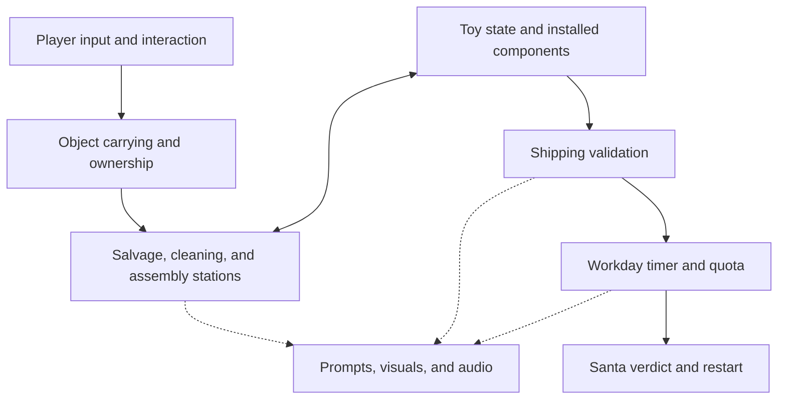

# Elf & Safety

A co-op toy-repair game where you are disposable elves in Santa's workshop. Turn old and broken toys into presents, meet the daily quota, and stay out of the furnace.

**Working title · Unity / C# · Solo-developed · Planned 2–4 player online co-op**

The workshop looks cheerful. Management is not.

## Current status

**Milestone 4 (two-player co-op proof) is implemented, and its two-player play test is pending.** One player hosts and a second joins. Both elves share one workshop: either player can carry toys, use every station, ship robots and clock in, and both see the same shift timer, shipped count and verdict. The host decides everything; the other player's actions are requests the host checks. All 30 automated PlayMode tests pass, but a second player joining can't be tested automatically, so the two-player checks below still need doing by hand.

Part 1 (shared workshop and carrying) was tried by the developer in Multiplayer Play Mode on 2026-11-03; the one issue reported, that Player 2 couldn't salvage, was part 1's intended host-only limit, which part 2 removes.

Milestone 3 is complete: one scored shift with a timer, quota, Santa's verdict and a trapdoor sequence on failure, verified by 11 automated workday tests and a developer play test on 2026-11-03 (table below).

Milestone 2 is complete: the repair loop passed its automated tests and a developer play test on 2026-11-03, confirmed in the editor log (table below).

| Milestone | Scope | Status |
|---|---|---|
| 1 — Workshop foundation | Graybox room, first-person movement, interaction targeting, pickup and drop | ✅ Complete (developer play-tested) |
| 2 — First toy loop | Robot delivery, salvage, cleaning, assembly, shipping | ✅ Complete (automated tests and developer play test) |
| 3 — A full workday | Timer, quota, Santa's verdict, trapdoor failure, restart | ✅ Complete (automated tests and developer play test) |
| 4 — Co-op proof | Two players sharing objects and synchronized workday state | 🟨 Implemented (parts 1 and 2); automated tests pass; two-player play test pending |

### Milestone 4 part 2 verification

| Check | How | Result |
|---|---|---|
| Scripts compile; builder adds the Workshop Sync prefab and registers it once | Batch mode, in a copy with settings identical to the developer's project | ✅ 0 errors, 0 warnings, 0 missing scripts |
| Milestones 2 and 3 and co-op part 1 regression | The 28 other PlayMode tests | ✅ Pass |
| Forwarded targets resolve on the host: a scene station by scene path, a robot part mount by robot plus mount path; the real station code runs; a repeated request is refused | `NetworkSessionTests` | ✅ Pass |
| Online shift: clock in works; shift state and shipped count are published; shipping the quota wins once; Play Again resets in place while still hosting (toys despawned, count 0, elf unfrozen); a second shift starts | `NetworkSessionTests` | ✅ Pass |
| Player 2 uses every station, ships, clocks in; both screens agree on timer, count, labels and verdict; both fall through the trapdoor on failure; Play Again from either player | Multiplayer Play Mode, by hand | ⬜ Pending; see [Co-op test](#co-op-test-two-players-on-one-pc) |

### Milestone 4 part 1 verification

| Check | How | Result |
|---|---|---|
| Netcode for GameObjects 2.13.3 and Multiplayer Play Mode 3.0.0 resolve offline (bundled with the editor) | Batch mode, in a copy with settings identical to the developer's project | ✅ |
| Scripts compile; builder adds network components to existing toy prefabs and creates the networked elf, the network manager prefab and the session | Batch mode, same copy | ✅ 0 errors, 0 warnings, 0 missing scripts |
| Milestones 2 and 3 regression (solo play) | The 24 existing PlayMode tests, unchanged | ✅ Pass |
| Solo play creates no network manager | `NetworkSessionTests` | ✅ Pass |
| Hosting clears practice items and replaces the solo elf with one networked, owned elf | `NetworkSessionTests` | ✅ Pass |
| Host: delivered items are spawned on the network; robot slots sync the actual part; dirty state syncs; carry state follows pick up and drop; installed parts stay on their mounts | `NetworkSessionTests` | ✅ Pass |
| Online: clocking in is refused | `NetworkSessionTests` | ✅ Pass |
| Leaving returns to solo with no network manager left behind | `NetworkSessionTests` | ✅ Pass |
| A second player joins, both elves move, both carry, no double-grabs, host actions show on the client | Multiplayer Play Mode, by hand | 🟨 Tried by the developer; the only issue reported was the intended part 1 host-only salvage limit. Not yet re-checked with part 2 |

### Milestone 3 verification

| Check | How | Result |
|---|---|---|
| Scripts compile; builder generates the new scene | Batch mode, in a copy with settings identical to the developer's project | ✅ 0 errors, 0 warnings, 0 missing scripts |
| Milestone 2 regression | The 13 existing PlayMode tests, unchanged | ✅ Pass |
| Defaults: 5:00, quota 2, timer stopped before clocking in | `WorkdayTests` | ✅ Pass |
| Clocking in clears practice items (including one in hand), zeroes the count and delivers one fresh batch | `WorkdayTests` | ✅ Pass |
| Request Delivery and DEV reset refused during the shift, even after every robot is gone | `WorkdayTests` | ✅ Pass |
| Rejected robots earn zero credit | `WorkdayTests` (all three delivered robots rejected) | ✅ Pass |
| Win: shipping the quota succeeds once; interactions, shipping and DEV reset stop | `WorkdayTests` | ✅ Pass |
| Timeout: fails once, trapdoor drops the player, then Retry with the furnace line | `WorkdayTests` | ✅ Pass |
| Deadline frame, quota shipment first: one verdict (success) | `WorkdayTests` | ✅ Pass |
| Deadline frame, timer first: the late shipment is refused, one verdict (failure) | `WorkdayTests` | ✅ Pass |
| Play Again and Retry each reload a fresh Workshop: timer, count, delivery, stations, carried item, trapdoor | `WorkdayTests` | ✅ Pass |
| Builder run in the developer's project | Menu, in the open editor | ✅ Scene rebuilt (previous scene backed up) |
| Clock in, then win by shipping 2 | Developer play test; editor log | ✅ Reported passing; the log shows "Shift started! Ship 2 robots in 5:00", then 1 and 2 shipped |
| Play Again returns to practice mode | Developer play test; editor log | ✅ Reported passing; the log shows practice deliveries and DEV resets working afterwards (only possible after a fresh reload), then a second clock-in |
| Timeout, trapdoor sequence, Retry | Developer play test; editor log | ✅ Reported passing; the log shows a 10-second shift starting. The verdict, fall and Retry write no log line, so the developer's report is the evidence |
| Delivery and DEV reset refused during a shift | Developer play test | ✅ Reported passing (prompt-only, so nothing is logged) |
| Rejected robot during a scored shift earns nothing | Developer play test; `WorkdayTests` | ✅ Reported passing and covered by the automated test; no rejection appears in the logged shift sessions |

### Milestone 2 verification

| Check | How | Result |
|---|---|---|
| Scripts compile (Runtime, Editor, Tests) | Developer's editor, Unity 6000.6.7f1 | ✅ 0 errors, 0 warnings |
| Builder generates scene, prefabs and batch asset | Batch mode, in a copy with identical settings | ✅ 0 import failures, 0 missing scripts |
| Rule tests (inspection reasons, batch solvability) | 4 PlayMode tests | ✅ Pass |
| Loop tests: delivery once as loose items, salvage once, blocked outputs, cleaning reservation, robots arriving and leaving by physics, assembly, rejections, repair and resubmit, second robot, reset | 9 PlayMode tests driving the real Workshop scene | ✅ Pass |
| Builder run in the developer's project | Menu, in the open editor | ✅ Scene rebuilt and backed up first; no old slot components left |
| First manual attempt (salvage) | Developer, in Play mode | ❌ NullReferenceException after a mid-Play recompile. Fixed; no exceptions in the play test after the fix |
| Movement, aiming, prompts, pickup, drop, free physics | Developer play test | ✅ Reported passing |
| Delivery | Developer play test; editor log | ✅ Reported passing; the log shows one delivery |
| Salvage without duplication | Developer play test; editor log | ✅ Reported passing; the log shows the battery and dead battery recovered once each |
| Cleaning | Developer play test; editor log | ✅ Reported passing; the log shows one body cleaned |
| Assembly, and shipping a valid robot | Developer play test; editor log | ✅ Reported passing; the log shows 1 robot shipped |
| Dirty and incomplete rejections with reasons | Developer play test; editor log | ✅ Reported passing; the log shows 3 rejections with the specific reasons |
| Dead-battery rejection | Developer play test; editor log | ✅ Log shows "body is dirty, battery is dead" rejection |
| Repair a rejected robot and resubmit; second robot shipped | Developer play test; editor log | ✅ Log shows the rejected robot's dead battery salvaged, the body cleaned, then 1 and 2 shipped |
| DEV reset keeps ownership and counter consistent | Developer play test; editor log | ✅ Two resets, each followed by a fresh delivery that spawned; no exceptions |
| Installing a dead battery at the assembly bench (warning shown) | Developer play test; editor log | ✅ Log shows "Installed Dead Battery. It's dead, so inspection will reject it" |

The tests call the same methods the interaction prompts call. They don't cover raycast aiming, prompt text, how attached parts look, or input. Every station posts a `[Workshop]` line to the Console, which is how the log evidence above was gathered.

**Recompiling during Play mode.** Unity recompiles changed scripts when you tab back in, even during Play. Ownership now survives that reload, which was the cause of the first manual crash. Other runtime state may still behave oddly after a mid-Play recompile, so set **Edit → Preferences → General → Script Changes While Playing → Recompile After Finished Playing**.

## Getting started

1. Clone this repository and add its project folder in Unity Hub.
2. Use **Unity 6000.6.7f1** (recorded in `ProjectSettings/ProjectVersion.txt`). The project uses URP, uGUI and the Input System package (Input System only) from the editor's URP Blank template, plus **Netcode for GameObjects 2.13.3** and **Multiplayer Play Mode 3.0.0**, both bundled with this editor.
3. Let Unity import the project.
4. **Generate the workshop scene:** run the menu **Elf & Safety → Build Workshop Scene**. This creates `Assets/_Project/Scenes/Workshop.unity` (it asks before overwriting, and offers to save unsaved scene changes), plus any toy prefabs, materials and the delivery batch asset that don't exist yet. Before overwriting, it copies the existing scene to `SceneBackups/Workshop_<date>_<time>.unity` next to `Assets/` (ignored by git, and not imported by Unity). To restore a backup, copy it back over `Assets/_Project/Scenes/Workshop.unity` while keeping that file's `.meta`. Prefabs, materials and the batch asset that already exist are never overwritten, so swapped-in art and tuned values survive a rebuild. Re-run it after pulling builder changes.
5. Press **Play**. Play always starts in the Workshop scene, whichever scene is open (turn this off with **Elf & Safety → Always Play From Workshop**). Test Runner sessions are exempt.

The builder can also run headless (it fails if the project is open in another editor):

```bash
"C:/Program Files/Unity/Hub/Editor/6000.6.7f1/Editor/Unity.exe" -batchmode -projectPath "D:/GameDev/ElfAndSafety" -executeMethod ElfAndSafety.EditorTools.WorkshopBuilder.BuildFromCommandLine -logFile build.log
```

### Running the tests

Use **Window → General → Test Runner → PlayMode → Run All**, or from the command line (with the project closed):

```bash
"C:/Program Files/Unity/Hub/Editor/6000.6.7f1/Editor/Unity.exe" -batchmode -projectPath "D:/GameDev/ElfAndSafety" -runTests -testPlatform PlayMode -testResults results.xml -logFile tests.log
```

The loop tests load the generated `Workshop` scene, so run the builder first. Keep the project at a short path: on Windows, a project nested deep under a long user folder can exceed the 260-character path limit, which breaks URP package imports and leaves generated assets with missing scripts.

### Controls

Bindings are defined in code in `Assets/_Project/Scripts/Runtime/Player/PlayerInputReader.cs`.

| Input | Action |
|---|---|
| W A S D / arrow keys | Move |
| Mouse | Look |
| Left Shift | Sprint |
| Space | Hop |
| E or left click | Interact: pick up, place, remove part, install part, ship, press a button (including **CLOCK IN**) |
| Q | Drop the carried item |
| Esc | Release the mouse; click the game view to capture it again (that click doesn't interact) |
| Mouse click or R (verdict screen) | Play Again / Retry |

### Co-op test (two players on one PC)

Milestone 4: two elves share one workshop and one shift. Solo play is unchanged and uses no networking.

1. Open **Window → Multiplayer → Multiplayer Play Mode** and tick **Player 2**. A second game window opens; give it a few seconds to load.
2. Press **Play**. Both windows start in solo practice, with a **CO-OP TEST** line in the bottom-left corner.
3. In the main window, press **F5** to host. In Player 2's window, click into it and press **F6** to join `127.0.0.1`. Each window removes its solo elf and spawns a networked one; the bottom-left line shows "hosting, 2 elves connected" or "joined".
4. **F8** leaves the session, and the Workshop reloads for solo play. If the host leaves, the client returns to solo too.

What works:
- Both elves move, and each sees the other move and look up and down.
- Either player can pick up, carry, drop (Q) and place (E on a station) any loose toy. The host decides every carry, so two players can never hold the same item.
- Either player can use everything: REQUEST DELIVERY and DEV RESET (in practice), salvage, cleaning, assembly, shipping and CLOCK IN. When Player 2 presses E, the request goes to the host, which checks it against its own state and runs the same station code. If it's no longer possible (someone else got there first), nothing happens.
- Loose toys fall and settle with physics on the host; the other player sees their synced positions. Installed parts stay attached to their robot on both screens.
- Both screens show the same shift timer, shipped count, cleaning progress, station labels and delivery status, and every station message appears for both players.
- One shared verdict. On success, both players get Santa's message. On failure, each player's elf is pulled onto the trapdoor and drops into the pit, and each sees the other fall.
- Play Again / Retry from either player resets the workshop for both without leaving the session: toys cleared, count 0, trapdoor closed, both elves back at the start in practice mode.

Limits of this proof:
- Station messages go to both players, including ones meant for the player who acted (such as "Output tray is blocked").
- There's no client prediction, so a client's actions wait for the host's reply. That's invisible on one PC, but noticeable over a real network.
- Shift length and quota come from the host; both machines should use the same scene settings.
- A player who joins mid-shift isn't handled specially.
- For a second PC on your network, set **Address** on the joining machine's **Network Session** object (Workshop scene) to the host's IP. Playing over the internet needs a relay service and is not part of this milestone.

### Playing a shift

1. You spawn in **practice mode**. Everything works but nothing counts, and the top of the screen says so. Look around, or try the loop with **REQUEST DELIVERY**.
2. Press E on the green **CLOCK IN** button on the red post just ahead and to the left of where you spawn. This removes any practice items (even one in your hands), sets the count to 0, drops the shift's batch onto the delivery table and starts the timer. The top of the screen shows the time left and **Shipped N / quota**; the time turns red under 30 seconds.
3. Repair and ship robots as described below. Only accepted shipments count; rejected robots earn nothing. During the shift, Request Delivery and DEV reset are refused, so the one batch is all you get. It always contains enough parts for exactly two robots.
4. **Reach the quota:** the shift ends at once. Santa congratulates you, with a **Play Again** button.
5. **Run out of time:** you're pulled onto the trapdoor in front of Santa's window, the doors swing open over an orange glow, and you drop into the furnace pit. Then *"You've been reassigned to furnace operations"* appears with **Retry**.
6. Once the shift ends, nothing can be picked up or shipped. Click the button or press **R** to reload a fresh Workshop: timer, count, delivery, stations and carried items all reset.

The deadline is strict. The timer is checked before player actions each frame, so a robot shipped in the very frame time runs out doesn't count, and there's only ever one verdict.

### Playing the repair loop

Every robot and part is a normal physics object: drop it anywhere with Q, knock it over, stack it. Stations don't lock items to a spot. Each one works on whichever robot is resting in its **work area** (the space above its gold pad), however it got there. Aiming at a station while carrying a robot offers **Place** (sets it down neatly on the pad), but dropping it onto the bench works too.

1. Press the green **REQUEST DELIVERY** button at the delivery chute (north-west corner). Six items drop onto the **Delivery Table** by the west wall: three robots (dirty with a dead battery and key; dirty and empty; clean with a working battery), a working battery, a winding key, and a dead battery. Enough usable parts for exactly two robots.
2. **Salvage:** put a robot on the salvage bench, then with empty hands aim at its battery or key and press E to remove it. Removed parts pop out loose onto the green parts tray (or into your hands if the tray spots are blocked).
3. **Clean:** put a dirty robot in the blue tub. Once it comes to rest, the station holds it upright and scrubs it for 3 seconds with a progress bar, then lets go. It can't be taken mid-scrub.
4. **Assemble:** put a robot on the assembly bench, carry a battery or key to it, aim at the robot or bench and press E to install it. The label lists the body, battery and key status.
5. **Ship:** carry a finished robot to the shipping chute and press E. Valid robots count once (the shipped count at the top of the screen). Invalid ones are dumped into the red-banded **Reject Bin** with the reasons.
6. The red **DEV: RESET TEST BATCH** button removes every delivered item, wherever it is, so you can request a fresh batch. The shipped counter is kept. It only works in practice mode, before clocking in.

Looking at a robot or part shows its status under the crosshair. Every station message is also written to the Console with a `[Workshop]` prefix.

## The game loop

1. **Receive:** broken toys arrive through a delivery chute.
2. **Sort:** decide what to repair and what to dismantle for parts.
3. **Salvage:** recover usable components at a workbench.
4. **Clean:** wash dirty toy bodies before assembly.
5. **Assemble:** fit compatible parts into a complete toy.
6. **Ship:** send finished presents through inspection for quota credit.
7. **Survive inspection:** meet quota before time runs out, or face Santa's cheerful disciplinary process.

The first prototype uses predictable deliveries so the loop can be tested. More varied deliveries and toy malfunctions come after the foundation works.

## Architecture — proposed responsibilities

This diagram describes the intended separation of responsibilities. It does not prescribe new class names or require a rewrite of milestone 1.



Gameplay rules should remain independent of visual models. A replacement robot mesh should not require changing the shipping rules; a new sound should not require rewriting assembly.

## Feature breakdown

✅ complete · 🟨 implemented, automated tests pass, manual play test pending · ⬜ planned

| Area | Feature | Status |
|---|---|---|
| Player | First-person movement and mouse look | ✅ |
| Interaction | Targeting, prompts, pickup, and drop | ✅ |
| Workshop | Initial graybox room | ✅ |
| Delivery | Repeatable, solvable robot test delivery | ✅ |
| Salvage | Recover installed parts without duplication | ✅ |
| Cleaning | Clean dirty bodies with visible progress | ✅ |
| Assembly | Attach battery and winding key to a robot body | ✅ |
| Shipping | Validate finished toys and award credit once | ✅ |
| Workday | Timer, quota, success, and restart (one repeatable shift) | ✅ |
| Workday | Multiple days and progression | ⬜ |
| Santa | Verdict messages and placeholder trapdoor punishment | ✅ |
| Co-op | Two-player shared workshop and carrying (part 1) | 🟨 |
| Co-op | Shared stations, shipping and shift (part 2) | 🟨 |
| Co-op | Expand to 2–4 players | ⬜ |
| Art | Finished elf and workshop models | ⬜ |

## Folder layout

Everything lives under `Assets/_Project/`. Runtime code is in the `ElfAndSafety.Runtime` assembly; editor tools are in the separate, editor-only `ElfAndSafety.Editor` assembly; tests are in `ElfAndSafety.Tests`. An audio folder doesn't exist yet and will be added when sound is.

| Path | Contents |
|---|---|
| `Scripts/Runtime/Player/` | `FirstPersonController`, `PlayerInputReader` (bindings, cursor lock) |
| `Scripts/Runtime/Interaction/` | `PlayerInteractor` (aiming, carrying), `Carryable` (single-owner physical object), `IInteractable`, `ICarryableOwner`, `IDescribable` |
| `Scripts/Runtime/Toys/` | `RobotBody` (dirty state, battery and key slots), `RobotPart`, `RobotSlotTarget` (aim target on a part mount), `RobotInspection` (shipping rules) |
| `Scripts/Runtime/Stations/` | `WorkStation` (work-area base class), `DeliveryChute`, `DeliveryButton`, `TestDeliveryBatch`, `SalvageBench`, `CleaningStation`, `AssemblyBench`, `ShippingChute`, `ShipmentCounter` |
| `Scripts/Runtime/Workday/` | `WorkdayManager` (shift state, timer, quota, the single verdict, restart), `ShiftButton` (CLOCK IN), `TrapdoorSequence` (failure cutscene) |
| `Scripts/Runtime/UI/` | `InteractionHud` (prompts, hints, status line, feedback), `WorkdayHud` (time, shipped versus quota, verdict panel and restart button) |
| `Scripts/Runtime/Core/` | `GameLayers`, `WorkshopFeedback` |
| `Scripts/Runtime/Net/` | `NetworkSession` (Host/Join/Leave, creates and destroys the network manager), `NetworkPlayer` (networked elf, carry requests to the host), `NetworkCarryable` (syncs owner state and loose pose), `NetworkRobot` (syncs dirty state and installed parts), `NetworkWorkshop` (shared shift, timer, count, station state and messages; Play Again for everyone) |
| `Scripts/Editor/` | `WorkshopBuilder` (scene generation), `PlayFromWorkshop` |
| `Tests/` | `RobotRulesTests`, `WorkshopLoopTests`, `WorkdayTests` (PlayMode) |
| `Prefabs/` | `Elf Player` (solo), `Elf Player (Net)` (variant used online), `Network Manager` (instantiated when hosting or joining), `Workshop Sync` (spawned by the host), `Robot Body`, `Battery`, `Dead Battery`, `Winding Key`. The three `Placeholder *` prefabs are milestone 1 leftovers and unused |
| `Assets/DefaultNetworkPrefabs.asset` | Netcode's own list of networked prefabs; Netcode keeps it up to date, and the network manager uses only this list |
| `Data/` | `Test Delivery Batch.asset` (delivery contents) |
| `Art/Materials/` | Flat-colour URP materials |
| `Scenes/` | `Workshop.unity` (generated) |

### Ownership model

A `Carryable` is in exactly one state at a time: `Loose` (a normal physics object, anywhere), `Held` (a player), `Installed` (a robot), `Reserved` (held still by a station operation, currently only the cleaning scrub) or `Consumed` (shipped or reset). Every transfer goes through one `Set*` method, which first notifies the previous owner (`ICarryableOwner.OnCarryableReleased`) so its reference is cleared. Destroying an object releases its owner the same way, and consuming a robot also consumes its installed parts. Stations never own loose items: each finds the robot resting in its work-area box every time it needs one, so a robot that is knocked or walks off a bench simply stops counting. The owner reference is a plain Unity-serializable field, so it survives a script recompile in Play mode. The state-changing methods (`PlayerInteractor.Request*`, `RobotBody.TryInstall`, `SalvageBench.TryRemovePart`, `AssemblyBench.TryInstallHeld`, `ShippingChute.TrySubmit`, `DeliveryChute.TryRequestDelivery` / `ResetTestBatch`) are the points a network host will validate in milestone 4.

### Replacing placeholder art

Each toy prefab's root holds the rigidbody, a simple box collider and the gameplay components; its `Visual` child holds the art. Replace the `Visual` child freely. Keep the robot's `Battery Mount` and `Key Mount` objects (installed parts attach there, and their triggers are the aim targets), and point `RobotBody`'s **Dirt Visual** field at whatever object shows dirt.

## Key ideas

- **A physical part has one owner.** A component can be loose, held, or installed. Transferring it must remove its previous ownership; it must never leave a duplicate behind.
- **Installed parts are explicit.** A robot's battery and key slots refer to actual components. Avoid separate flags that disagree with what is attached.
- **Stations have clear occupancy.** A station accepts compatible objects, reserves them during an operation, and returns outputs to reachable positions.
- **Shipping is the validation boundary.** Only valid toys earn credit, and each accepted toy can count once. Rejections explain the problem and return the object safely.
- **Reliable interaction comes first.** Use stable carrying and attachment points. Loose objects can use physics, but essential crafting should not depend on unstable joints.
- **Visuals are replaceable.** Keep simple colliders and gameplay components separate from detailed art. Primitive placeholders are enough to prove the loop.
- **Deliveries must be solvable.** The prototype delivery includes enough usable parts for at least two finished robots. Random shortages should not accidentally make the test unwinnable.
- **Co-op changes ownership rules.** Keep pickup, assembly, shipping, and workday changes behind clear methods suitable for host authority. Netcode for GameObjects is the chosen package, with the host as the referee: a client sends requests and mirrors the results. Prove two-player behavior before expanding content.
- **Everyone can do every job.** Fixed character classes are outside the first prototype. Players decide who sorts, cleans, assembles, and ships.

## First toy: wind-up robot

| Component | State | Shipping requirement |
|---|---|---|
| Robot body | Clean or dirty | Clean |
| Battery | Working or dead | Working and installed |
| Winding key | Present or missing | Installed |

A dead battery may be installed for diagnosis and repair, but the robot cannot pass inspection until it is replaced. Installed parts must be visibly represented.

### First stations

| Station | Input | Action / output |
|---|---|---|
| Delivery chute | Request button (one batch at a time) and DEV reset button | Three robots and three loose parts dropped onto the delivery table's six spots; refused while the spots are cluttered |
| Salvage bench | The robot resting in its work area | Aim at an installed part to remove it; it pops out loose at the first clear tray spot, or into the player's hands if all three are blocked |
| Cleaning station | One dirty body | 3-second automatic scrub with progress bar; body locked until clean; clean bodies refused |
| Assembly bench | The robot resting in its work area, then carried parts | Installs the carried part into its empty slot; status label shows what's missing |
| Shipping chute | Carried robot | Accepts a valid robot once, or drops it loose into the reject bin with the reasons (stays in hand if all three drop spots are blocked) |

## How to add things

These are extension guidelines. Replace them with exact file references as systems are implemented.

| I want to add… | Approach |
|---|---|
| A new toy | Define its required components and conditions; reuse the existing station loop before adding special behavior |
| A new component | Define compatible slots, visible representation, and any condition that affects validation |
| A station | Reuse interaction and ownership rules; specify accepted inputs, operation, and accessible output positions |
| A replacement model | Replace the visual child or prefab while preserving gameplay references, attachment points, scale, and colliders |
| A malfunction | Add a readable cause, visible feedback, and a recovery action after the basic loop is stable |
| Santa dialogue | Trigger it from workday events; do not put quota logic inside dialogue code |
| A quota rule | Change workday configuration and test its relationship to deliveries and day length |
| A multiplayer interaction | Resolve ownership and validate the operation on the host; synchronize its result |

## Tuning

Keep relevant values editable rather than scattering unexplained constants through scripts.

| Setting | What it changes | Where |
|---|---|---|
| Movement speed / mouse sensitivity | Player movement and camera feel | `Elf Player` prefab → First Person Controller |
| Interaction reach / carry distance | How players target and transport objects | `Elf Player` prefab → Player Interactor (reach); `Hold Point` child position |
| Cleaning duration | Cleaning workload and station bottlenecks | Workshop scene → Cleaning Station → Work Area → Clean Duration (3 s) |
| Delivery composition | Available bodies, usable components, and repair decisions | `Data/Test Delivery Batch.asset`. Deliveries are refused if it can't complete at least two robots, or has more items than the 6 delivery-table spots |
| Shift length / quota | Production pressure and win conditions | Workshop scene → **Workday** object → Workday Manager → **Shift Length Seconds** (300) and **Quota** (2) |
| Santa's lines | Verdict titles and messages | Workday Manager → Santa section |
| Trapdoor timing | How long the failure sequence takes before Retry | Workshop scene → Room → **Trapdoor** → Trapdoor Sequence (gather 0.7 s, open 0.5 s, fall 1.3 s) |
| Time warning | When the timer turns red | HUD → Workday Hud → Warning Seconds (30) |

Values set on scene objects are regenerated by **Build Workshop Scene**; prefab and asset values are kept.

Do not balance for four players before validating the local loop and two-player proof. Co-op tuning should consider travel, handoffs, and station congestion as well as player count.

## Art direction

Chunky low-poly shapes, flat colors, readable silhouettes, and minimal surface detail. Cute Christmas decorations share space with hazard stripes, industrial equipment, and a suspiciously warm trapdoor.

- **Elves:** pointed ears, oversized noses, mittens, big boots, expressive simple faces.
- **Toys:** visibly separate components and easily recognized broken states.
- **Stations:** obvious work surfaces, input positions, and output areas.
- **Santa:** cheerful, increasingly threatening management; cartoon scares without realistic gore.

Start with primitives. Final models are not a prerequisite for testing the game.

## Manual checks

Run the checks relevant to the milestone being changed. Planned-system checks become applicable when those systems exist.

- **Foundation:** movement, mouse look, prompts, pickup, and drop work without held objects hitting the player or launching away.
- **Play start:** with `SampleScene` open, pressing Play starts in the workshop.
- **Free physics:** drop robots and parts anywhere with Q; they fall and settle. A robot dropped onto a bench (not placed) is recognised by it; push it off and the bench label goes back to empty.
- **Delivery:** the request button drops six items onto the delivery table once; pressing it again shows a refusal instead of spawning more.
- **Salvage:** the battery and key are aimable on a benched robot, each removes once, and parts pop out onto the green tray. With all three tray spots blocked, the next part goes into your hands, and a further removal is refused with a message.
- **Installed parts:** parts visibly sit on the robot and move with it when carried; they can't be picked up off the robot.
- **Cleaning:** the progress bar fills, dirt smudges disappear, the body can't be taken mid-scrub, and a clean body is refused with "Already clean".
- **Assembly:** the label shows missing parts and dirt; a dead battery installs with a warning and shows DEAD; a second battery is refused with the part kept in hand.
- **Invalid toys:** dirty, incomplete, and dead-battery robots are dumped in the reject bin with the specific reasons.
- **Repair and resubmit:** salvage the dead battery from a rejected robot, clean it, fit a working battery, and ship it.
- **Second robot:** completes and ships; the counter reads 2.
- **Ownership:** spamming E at stations and the chute can't duplicate parts, install two parts in one slot, or add credit. DEV reset mid-cleaning and while carrying a part clears everything, leaves nothing stuck in your hands, and lets a fresh batch be requested.
- **Clock in:** before clocking in, the top of the screen says PRACTICE and the timer doesn't move. Pressing E on CLOCK IN clears practice items and starts a 5:00 countdown with **Shipped 0 / 2**.
- **During the shift:** REQUEST DELIVERY and DEV RESET show "Disabled during a scored shift". A rejected robot leaves the count unchanged.
- **Win:** shipping the second valid robot shows Santa's message and **Play Again** at once. You can't move or interact, and the mouse is free to click the button.
- **Timeout:** with the quota unmet when time runs out (set Shift Length Seconds to 30 on the Workday object to test quickly), you're pulled onto the trapdoor, the doors open over an orange glow, you fall, and *"You've been reassigned to furnace operations"* appears with **Retry**.
- **Restart:** Play Again and Retry (click or R) each return to practice mode with the timer at 5:00, Shipped 0, an empty delivery table, idle stations, empty hands and the trapdoor closed.
- **Co-op part 1** (Multiplayer Play Mode, see [Co-op test](#co-op-test-two-players-on-one-pc)):
  - Host with F5 and join with F6; each window shows exactly one elf of its own plus the other player's elf.
  - Walking and looking up and down show on the other screen.
  - The host requests a delivery; six toys appear on both screens, with installed parts on the robots.
  - Each player picks up and carries a toy; the other sees it in their hands. Both press E on the same toy at once: only one gets it, and the other's prompt doesn't offer it.
  - Dropping (Q) and placing on a station work for both, and the toy lands in the same spot on both screens.
  - F8 on either side returns both to solo; a fresh F5/F6 works again.
- **Co-op part 2** (same setup):
  - Player 2 puts a robot on the salvage bench and removes its battery and key; the parts pop out on both screens, and pressing E again removes nothing more.
  - Player 2 drops a dirty robot in the tub; the progress bar fills on both screens and the body turns clean on both.
  - Player 2 installs parts at the assembly bench; the bench label updates on both screens.
  - Player 2 ships a robot. A valid one raises the count on both screens; an invalid one lands in the reject bin with the reasons shown to both players.
  - Player 2 presses CLOCK IN; the timer and Shipped 0 / 2 appear on both screens. During the shift, REQUEST DELIVERY and DEV RESET refuse for both players.
  - Both players ship robots: the second accepted robot ends the shift once, and both see Santa's message. Play Again from Player 2 resets both into practice mode, still connected.
  - With Shift Length Seconds set to 30 (host's Workday object), let time run out: both elves fall through the trapdoor, each sees the other fall, and Retry from either player resets both.

## Development workflow

- Work in small milestones that leave a playable result.
- Read the repository's current implementation before introducing another system that solves the same problem.
- Commit Unity `.meta` files alongside their assets. Exclude generated caches, build output, and secrets using a Unity-appropriate `.gitignore`.
- Keep the project's editor version and package changes deliberate and documented.
- Verify compilation and relevant behavior before marking a feature complete. Distinguish automated checks from manual gameplay checks.
- Update this README when controls, setup, structure, or feature status changes. Replace proposed documentation with verified paths and names as the implementation settles.

## Scope boundary

First prove one room, one toy, one workday, and two players. Additional toys, elaborate malfunctions, shop upgrades, cosmetics, procedural maps, and broader progression can follow once that foundation is fun and reliable.
